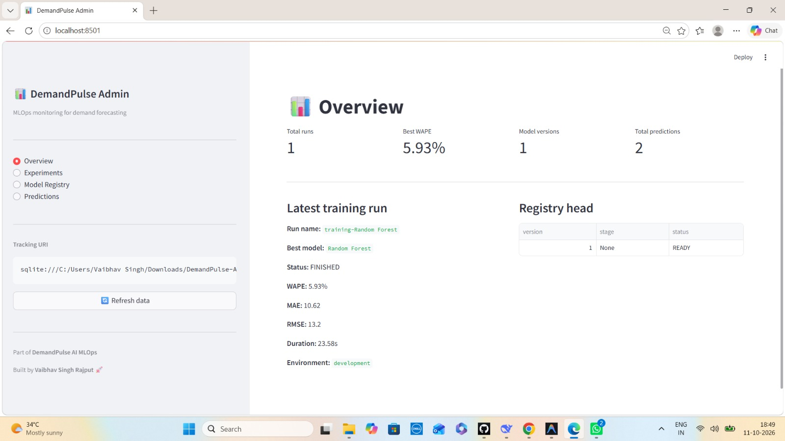
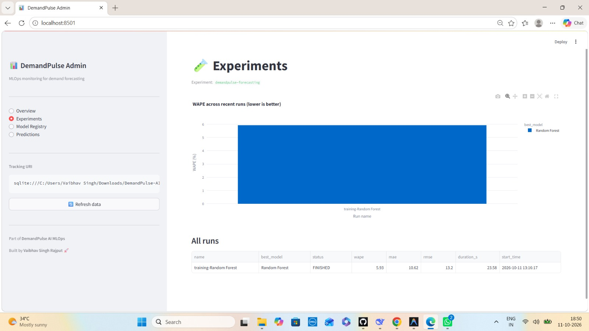
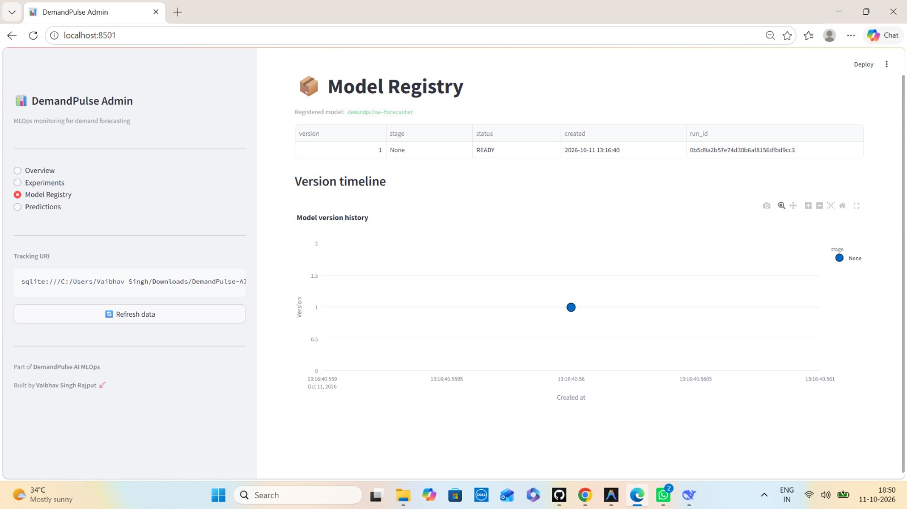
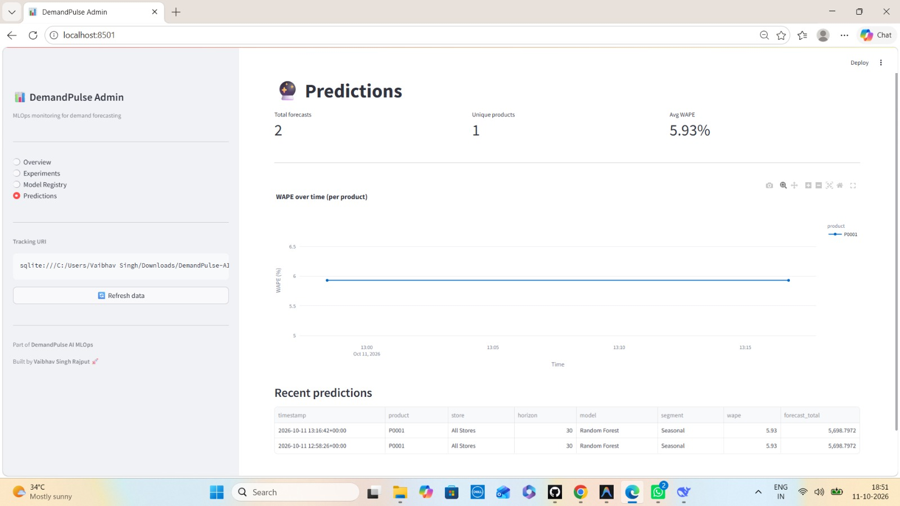
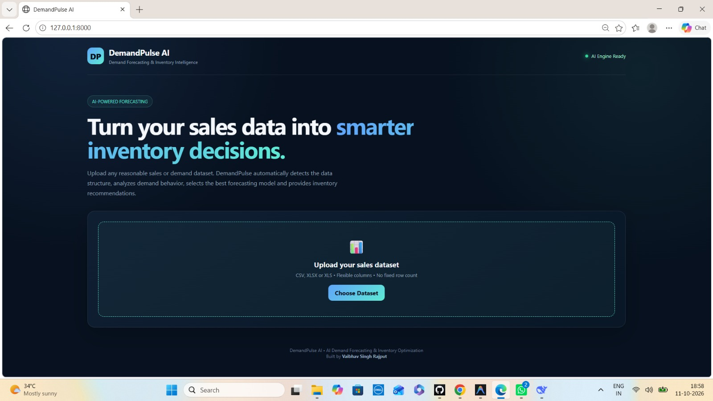

# 📊 DemandPulse MLOps Platform

### End-to-End Demand Forecasting & MLOps Platform

<p align="center">
  <strong>Forecast demand. Track experiments. Version models. Deploy with confidence.</strong>
</p>

🌐 **Live Demo:** [demandpulse-mlops.onrender.com](https://demandpulse-mlops.onrender.com/) •
📘 **API Docs:** [demandpulse-mlops.onrender.com/docs](https://demandpulse-mlops.onrender.com/docs) •
📊 **Admin Dashboard:** [demandpulse-vaibhav.streamlit.app](https://demandpulse-vaibhav.streamlit.app)

---

<p align="center">
  <a href="https://github.com/vaibhav07772/DemandPulse-MLOps-Platform/actions/workflows/ci.yml">
    
  </a>
  
  
  
  
  
  
  
  
  
  
</p>

<p align="center">
  🧪 <a href="#-running-tests"><b>Tests</b></a> •
  🔬 <a href="#-mlflow--experiment-tracking"><b>MLflow</b></a> •
  📊 <a href="#-streamlit-admin-dashboard"><b>Admin Dashboard</b></a> •
  🐳 <a href="#-docker"><b>Docker</b></a> •
  🚀 <a href="#-deployment"><b>Deploy</b></a>
</p>

---

## 🚀 Overview

**DemandPulse MLOps Platform** is a production-oriented demand forecasting system that combines a **FastAPI backend**, an **interactive user dashboard**, a **Streamlit admin panel**, a modular **machine learning pipeline**, and a full **MLOps stack** for experiment tracking, model registry, data versioning, automated testing, and CI/CD.

The platform ingests historical demand data, validates it against a strict schema, engineers time-aware features, benchmarks **Random Forest, XGBoost, and LightGBM** via **time-series cross-validation**, and produces **recursive multi-step forecasts** with prediction intervals — all while logging every training run to **MLflow**, versioning the winning model in the **model registry**, and streaming metrics to **Prometheus**.

It turns raw sales data into **tracked, versioned, deployable forecasts**.

---

## ✨ Key Features

### 🧠 Machine Learning
- **Multi-model benchmarking** — Random Forest, XGBoost, LightGBM compete on every training run
- **Time-series cross-validation** — Walk-forward splits prevent data leakage
- **Automatic model selection** — Winner chosen by lowest WAPE
- **Recursive forecasting** — Multi-step (7 / 30 / 60 / 90 days) with prediction intervals
- **Demand segmentation** — Series classified as Stable / Trending / Seasonal / Volatile
- **Smart model caching** — Thread-safe LRU cache avoids retraining identical histories

### 🔬 MLOps
- **MLflow experiment tracking** — Params, metrics (WAPE / MAE / RMSE), nested per-model runs
- **Model registry** — Best model auto-registered as `demandpulse-forecaster` with versioned releases
- **SQLite backend** — Tracking + registry works cross-platform (Windows / Linux / macOS)
- **Data versioning (DVC)** — Sample datasets versioned separately from code
- **Schema validation (Pandera)** — Strict dtype, range, null checks on uploads
- **Structured logging (structlog)** — JSON-ready logs with per-request `request_id`
- **Prometheus monitoring** — `/metrics` endpoint with HTTP, forecast, and training metrics
- **Prediction logging** — Every forecast persisted to `predictions.jsonl` for audit / drift analysis
- **Environment-driven config** — `pydantic-settings` with `.env` support

### 🖥️ Product Surface
- **Main dashboard** — Upload, configure, forecast, compare, visualize
- **Streamlit admin panel** — Live MLOps monitoring (runs, registry, predictions)
- **REST API** — Versioned, Swagger-documented FastAPI endpoints
- **Inventory intelligence** — Reorder point, safety stock, lead-time demand
- **Multi-format uploads** — CSV, XLSX, XLS with flexible column detection

### 🛠️ Engineering
- **24+ automated tests** — pytest suite covering API, config, forecasting, metrics
- **CI/CD** — GitHub Actions runs lint, tests, and Docker build on every push
- **Pre-commit hooks** — Ruff linting + formatting, YAML checks, secret detection
- **Dockerized** — Ready for containerized deployments

---

## 📸 Screenshots

### Streamlit Admin Dashboard — Overview


### Experiments — WAPE Comparison Across Runs


### Model Registry — Versioned Releases


### Predictions — Live Forecast Log


### Main User Dashboard


---

## 🏗️ System Architecture

```text
                         User
                          │
                          ▼
                  Web Dashboard
               HTML / CSS / JavaScript
                          │
                          ▼
                   FastAPI Backend
                     app/main.py
          ┌───────────────┼───────────────┐
          ▼               ▼               ▼
     Upload API      Forecast API    Compare API
          │               │               │
          └───────┬───────┴───────┬───────┘
                  ▼               ▼
            Validation     Session Store
                  │
                  ▼
            Data Pipeline
          ┌───────┼───────┐
          ▼       ▼       ▼
    Preprocess  Feature  Segmentation
                Engg.
          └───────┬───────┘
                  ▼
        Time-Series CV Tuning
        ┌─────────┼─────────┐
        ▼         ▼         ▼
   Random     XGBoost   LightGBM
   Forest
        └─────────┼─────────┘
                  ▼
        MLflow Experiment Tracking
                  │
                  ▼
       Best Model → Model Registry
                  │
                  ▼
         Recursive Forecasting
                  │
        ┌─────────┴─────────┐
        ▼                   ▼
   Prometheus           Prediction Logs
   /metrics             predictions.jsonl
        │                   │
        └─────────┬─────────┘
                  ▼
        Streamlit Admin Dashboard
        (Runs · Registry · Predictions)
```

---

## 🛠️ Tech Stack

| Layer | Technology |
| --- | --- |
| **Backend** | Python 3.11, FastAPI, Uvicorn, Pydantic v2 |
| **ML / Forecasting** | scikit-learn, XGBoost, LightGBM, pandas, NumPy |
| **MLOps** | MLflow (tracking + registry), DVC, Pandera, structlog, pydantic-settings |
| **Admin UI** | Streamlit, Plotly |
| **Frontend** | HTML5, CSS3, vanilla JavaScript |
| **Monitoring** | Prometheus client, `/metrics` endpoint |
| **Testing & Quality** | pytest, pytest-cov, Ruff, pre-commit |
| **CI/CD** | GitHub Actions |
| **Containerization** | Docker |
| **Deployment** | Render (app), Streamlit Cloud (admin) |

---

## 📂 Project Structure

```text
DemandPulse-MLOps-Platform/
│
├── admin/                          # Streamlit admin dashboard
│   ├── app.py
│   ├── requirements.txt
│   └── README.md
│
├── app/
│   ├── mlops/
│   │   └── mlflow_utils.py         # MLflow tracking + registry helpers
│   │
│   ├── monitoring/                 # Prometheus metrics + prediction logs
│   │   ├── metrics.py
│   │   └── predictions.py
│   │
│   ├── pipeline/
│   │   ├── data_adapter.py
│   │   ├── feature_engineering.py
│   │   ├── forecasting.py          # Recursive forecasting + caching
│   │   ├── inventory.py
│   │   ├── models.py               # RF / XGBoost / LightGBM builders
│   │   ├── preprocessing.py
│   │   ├── schema.py               # Pandera schema
│   │   ├── segmentation.py
│   │   ├── tuning.py               # TimeSeriesSplit CV + MLflow
│   │   ├── upload_loader.py
│   │   └── validation.py
│   │
│   ├── services/
│   │   └── session_store.py
│   │
│   ├── static/                     # CSS / JS for main dashboard
│   ├── templates/                  # HTML for main dashboard
│   ├── config.py
│   ├── logging_config.py
│   ├── middleware.py
│   └── main.py
│
├── data/
│   ├── sample/                     # DVC-tracked sample dataset
│   ├── logs/                       # Prediction logs (gitignored)
│   ├── sessions/                   # Runtime sessions
│   └── uploads/                    # Runtime uploads
│
├── docs/                           # README screenshots
│
├── scripts/
│   └── make_sample_data.py
│
├── tests/
│   ├── conftest.py
│   ├── test_api.py
│   ├── test_config.py
│   ├── test_forecasting.py
│   ├── test_health.py
│   └── test_metrics.py
│
├── .github/workflows/ci.yml        # Lint + test + docker build
├── .dvc/                           # DVC metadata
├── .env.example
├── .gitignore
├── .pre-commit-config.yaml
├── Dockerfile
├── pyproject.toml                  # Ruff + pytest + coverage
├── pytest.ini
├── requirements.txt
├── requirements-dev.txt
├── run.py
└── README.md
```

---

## ⚙️ Getting Started

### Prerequisites
- Python **3.11**
- Git
- Docker Desktop *(optional)*

### 1. Clone

```bash
git clone https://github.com/vaibhav07772/DemandPulse-MLOps-Platform.git
cd DemandPulse-MLOps-Platform
```

### 2. Virtual environment

**Windows PowerShell**
```powershell
python -m venv .venv
.\.venv\Scripts\Activate.ps1
```

**macOS / Linux**
```bash
python3 -m venv .venv
source .venv/bin/activate
```

### 3. Install dependencies

**Runtime:**
```bash
python -m pip install --upgrade pip
pip install -r requirements.txt
```

**With dev tooling:**
```bash
pip install -r requirements-dev.txt
pre-commit install
```

### 4. Configure (optional)

```bash
cp .env.example .env
```

All settings have safe defaults — app runs even without `.env`.

### 5. ▶️ Run the main app

```bash
python run.py
```

Open:
- **Dashboard:** http://127.0.0.1:8000
- **API Docs:** http://127.0.0.1:8000/docs
- **Metrics:** http://127.0.0.1:8000/metrics

---

## 🔬 MLflow — Experiment Tracking & Model Registry

Every training run is logged to MLflow. The platform uses a **SQLite backend** so tracking *and* model registry work cross-platform.

Launch the MLflow UI:

```bash
mlflow ui --backend-store-uri sqlite:///mlflow.db --port 5000
```

Open **http://127.0.0.1:5000** to explore:

- **Experiment:** `demandpulse-forecasting`
- **Nested runs:** one per candidate model (Random Forest / XGBoost / LightGBM)
- **Metrics:** `best_wape`, `best_mae`, `best_rmse`
- **Params:** `rows`, `feature_count`, `candidate_models`, hyperparameters
- **Artifacts:** serialized sklearn model + signature
- **Models tab:** `demandpulse-forecaster` registry with versioned releases

Every retrain adds a **new version** to the registry automatically.

---

## 📊 Streamlit Admin Dashboard

A separate Streamlit panel gives you live MLOps visibility:

```bash
pip install -r admin/requirements.txt
streamlit run admin/app.py
```

Open **http://localhost:8501**

| Tab | What It Shows |
| --- | --- |
| **Overview** | Total runs, best WAPE, model versions, prediction count |
| **Experiments** | WAPE comparison chart + full run table |
| **Model Registry** | `demandpulse-forecaster` versions + timeline |
| **Predictions** | Live prediction log + WAPE trend |

**Data sources:**
- MLflow SQLite DB: `./mlflow.db`
- Prediction log: `data/logs/predictions.jsonl`

---

## 📖 How to Use

1. Open the dashboard at http://127.0.0.1:8000
2. Upload a demand dataset (CSV / XLSX / XLS) — try `data/sample/demand_sample.csv`
3. Select a **product** and optionally a **store**
4. Choose a **forecast horizon** (7 / 30 / 60 / 90 days)
5. Optionally set **current stock**, **lead time**, and **safety stock days**
6. Click **Run Forecast**
7. Review model metrics, forecast chart, and inventory recommendations
8. Compare two products via the **Product Comparison** panel
9. Check the **Streamlit admin** at http://localhost:8501 for MLOps monitoring

---

## 🔌 API Reference

Interactive documentation:

- **Swagger UI:** http://127.0.0.1:8000/docs
- **ReDoc:** http://127.0.0.1:8000/redoc

| Method | Endpoint | Purpose |
| --- | --- | --- |
| `GET` | `/` | Main dashboard HTML |
| `GET` | `/metrics` | Prometheus metrics |
| `GET` | `/health` | Service health + version |
| `GET` | `/health/live` | Liveness probe |
| `GET` | `/health/ready` | Readiness probe |
| `POST` | `/api/upload` | Upload + validate dataset |
| `POST` | `/api/forecast` | Generate forecast |
| `POST` | `/api/compare` | Compare two products |
| `GET` | `/api/insights/{session}` | Dataset-level insights |

---

## 🔄 MLOps Workflow

```text
Data Ingestion ─► Pandera Validation ─► Preprocessing ─► Feature Engineering
                                                                │
                                                                ▼
                                                   Time-Series CV Tuning
                                                                │
                                              ┌─────────────────┼─────────────────┐
                                              ▼                 ▼                 ▼
                                        Random Forest       XGBoost          LightGBM
                                              │                 │                 │
                                              └─────────────────┼─────────────────┘
                                                                ▼
                                                MLflow Experiment Tracking
                                                                │
                                                                ▼
                                                Best Model → Model Registry
                                                                │
                                              ┌─────────────────┴─────────────────┐
                                              ▼                                   ▼
                                    Recursive Forecasting              Prometheus Metrics
                                              │                                   │
                                              ▼                                   ▼
                                    Prediction Log (JSONL)          Streamlit Admin Dashboard
```

---

## 🧪 Running Tests

```bash
pytest -v
```

**24 tests** covering API, config, forecasting, metrics, and health. Coverage report generated automatically.

### Lint & format

```bash
ruff check app tests
ruff format app tests
```

### Pre-commit

```bash
pre-commit run --all-files
```

---

## 🐳 Docker

Build:

```bash
docker build -t demandpulse-mlops .
```

Run:

```bash
docker run --rm -p 8000:8000 \
  -e MLFLOW_ENABLED=false \
  -v "$(pwd)/data:/app/data" \
  demandpulse-mlops
```

Open **http://127.0.0.1:8000**.

> Use `MLFLOW_ENABLED=false` inside containers unless you mount `mlflow.db` and `mlruns/` as volumes.

---

## ⚙️ Configuration Reference

All settings driven by environment variables (see `.env.example`):

| Variable | Default | Purpose |
| --- | --- | --- |
| `ENVIRONMENT` | `development` | Deployment environment |
| `LOG_LEVEL` | `INFO` | Logging level |
| `LOG_JSON` | `false` | Emit JSON logs |
| `MAX_UPLOAD_BYTES` | `52428800` | Upload size cap (50 MB) |
| `ALLOWED_EXTENSIONS` | `.csv,.xlsx,.xls` | Permitted upload formats |
| `ALLOWED_HORIZONS` | `7,30,60,90` | Valid forecast horizons |
| `MAX_CACHED_MODELS` | `2` | In-memory cache size |
| `MLFLOW_ENABLED` | `true` | Toggle MLflow tracking |
| `MLFLOW_TRACKING_URI` | `sqlite:///mlflow.db` | MLflow backend |
| `MLFLOW_ARTIFACT_LOCATION` | `./mlruns` | Model artifact storage |
| `MLFLOW_EXPERIMENT_NAME` | `demandpulse-forecasting` | Experiment name |
| `MLFLOW_REGISTERED_MODEL_NAME` | `demandpulse-forecaster` | Registry model name |
| `MLFLOW_AUTO_REGISTER` | `true` | Auto-register winning model |

---

## 🚀 Deployment

### Main App → Render

1. Push repo to GitHub
2. Render → **New Web Service** → connect repo
3. **Build Command:** `pip install -r requirements.txt`
4. **Start Command:** `uvicorn app.main:app --host 0.0.0.0 --port $PORT`
5. **Env vars:**
   ```
   ENVIRONMENT=production
   LOG_JSON=true
   MLFLOW_ENABLED=false
   ```

### Admin Dashboard → Streamlit Cloud

1. Go to https://share.streamlit.io
2. **New app** → select repo
3. **Main file path:** `admin/app.py`
4. **Requirements file:** `admin/requirements.txt`
5. Deploy

> **Note:** Streamlit Cloud cannot read your local `mlflow.db`. For cloud monitoring you need a remote MLflow tracking server (e.g., DagsHub, self-hosted) and point `MLFLOW_TRACKING_URI` to it.

---

## 🗺️ Roadmap

- [x] Structured logging with request IDs
- [x] Environment-driven configuration
- [x] MLflow experiment tracking + model registry
- [x] Automated tests + GitHub Actions CI
- [x] Pre-commit hooks + Ruff linting
- [x] Data versioning with DVC
- [x] Schema validation with Pandera
- [x] Prometheus `/metrics` endpoint
- [x] Streamlit admin dashboard
- [x] Prediction logging for audit / drift
- [ ] Drift detection (Evidently AI)
- [ ] Automated retraining pipeline
- [ ] Docker Compose (app + MLflow server)
- [ ] Multi-user session persistence (Redis)
- [ ] Remote MLflow tracking for cloud admin dashboard

---

## 🤝 Contributing

1. Fork the repository
2. Create a feature branch (`git checkout -b feature/amazing`)
3. Commit changes (`git commit -m "Add amazing feature"`)
4. Push (`git push origin feature/amazing`)
5. Open a Pull Request

Make sure `ruff check app tests` and `pytest -v` pass before opening a PR.

---

## 🔒 Security

- Keep API keys and credentials out of source control
- Use environment variables or a secrets manager
- Validate uploaded files before processing
- Avoid exposing internal stack traces to public users
- Exclude virtual environments, caches, and private data from Git
- Configure access controls for uploaded datasets and session storage

---

## 🙏 Credits

**Original project foundation** — [@prajapatishubham336](https://github.com/prajapatishubham336)

**MLOps enhancements, monitoring, admin dashboard, and productionization** — Vaibhav Singh Rajput

---

## 👨‍💻 Author

**Vaibhav Singh Rajput**
AI/ML Engineer | Machine Learning | MLOps | Generative AI

GitHub: [@vaibhav07772](https://github.com/vaibhav07772)

---

<p align="center">
  <strong>DemandPulse MLOps Platform</strong><br>
  <em>From demand data to tracked, versioned, deployable forecasts.</em>
</p>
